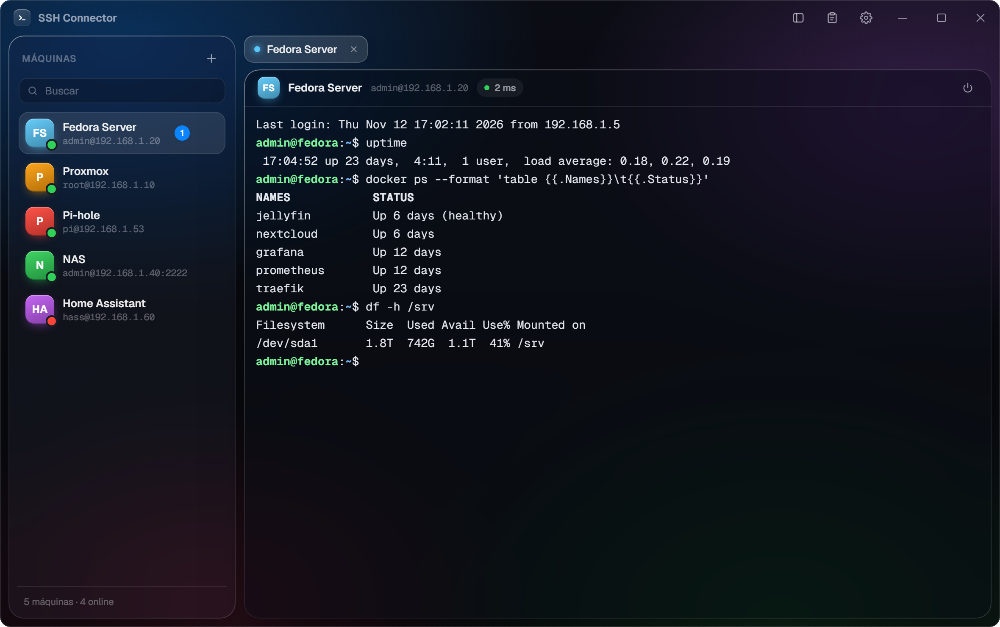

# SSH Connector

Cliente SSH minimalista em estilo liquid glass (Tauri 2 + Rust/russh + xterm.js).



- **Download:** [`SSH-Connector.exe`](https://github.com/joaoluft/liquid-glass-ssh-connector/releases/latest) (portátil, ~4,5 MB; usa o WebView2 do Windows)
- Configuração: `%APPDATA%\SSHConnector\config.json` (senhas cifradas com DPAPI do Windows)

## Compilar
```
cd src-tauri
cargo build --release
copy target\release\ssh-connector.exe "..\dist\SSH Connector.exe"
```

## Personalizar
A engrenagem na barra de título (ou `Ctrl+,`) abre o painel de personalização, tudo aplicado na hora:

- **Tema:** 8 temas prontos, cor de destaque (paleta ou qualquer cor), papel de parede (8 gradientes, cor sólida ou imagem sua, com escurecer/desfocar), transparência do app e dos blocos, cor e intensidade do vidro
- **Terminal:** fonte, tamanho, peso, altura da linha, espaço entre letras, esquema de cores, contraste mínimo, formato e piscar do cursor, margem interna, histórico de linhas
- **Interface:** fonte da interface, escala, arredondamento, densidade, barra lateral (mostrar/ocultar, largura), botões da janela estilo Windows ou macOS, animações
- **Servidores:** ícone personalizado para cada máquina
- **Exportar / Importar** o tema pela área de transferência para levar a outro PC

## Área de transferência
O app tem um clipboard próprio (botão na barra de título ou `Ctrl+Shift+V`): tudo que você copia em
qualquer terminal fica num histórico, e um clique cola o item no terminal ativo, ideal para levar comandos
de uma máquina para outra. Itens podem ser fixados. O histórico fica só na memória e some ao fechar o app.

## Atalhos
| Ação | Atalho |
| --- | --- |
| Copiar seleção | `Ctrl+C` (com texto selecionado) · `Ctrl+Shift+C` · `Ctrl+Insert` |
| Colar | `Ctrl+V` · `Shift+Insert` |
| Área de transferência | `Ctrl+Shift+V` · teclas `1`–`9` colam um item com o painel aberto |
| Menu do terminal | clique direito (copiar, colar, selecionar tudo, limpar) |
| Nova máquina / buscar | `Ctrl+N` / `Ctrl+F` |
| Personalizar / barra lateral | `Ctrl+,` / `Ctrl+Shift+B` |
| Abrir já conectado | `"SSH Connector.exe" --connect "Nome da máquina"` |
| Aparência (transparência, fonte) | `Ctrl+,` · engrenagem na barra de título |
| Trocar / fechar aba | `Ctrl+Tab` / `Ctrl+Shift+W` |
